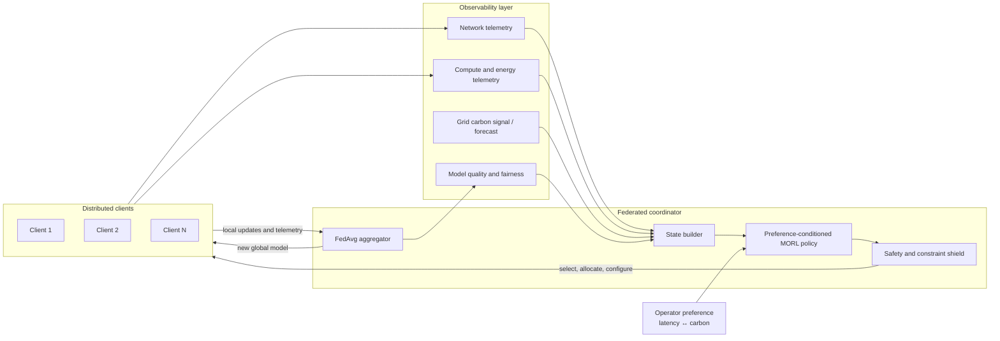
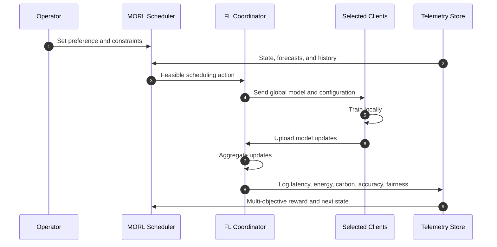
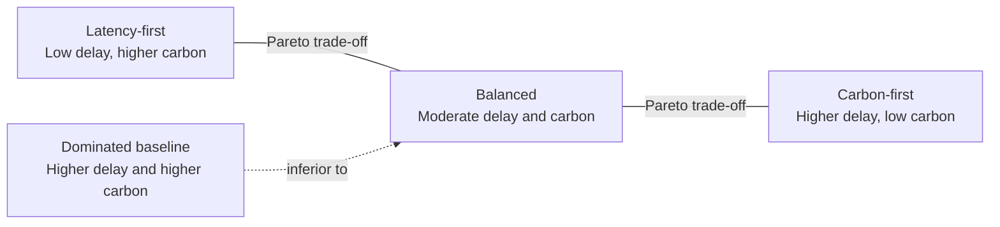
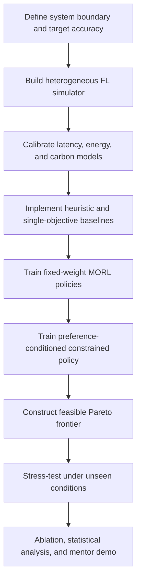

# Carbon-Aware Federated Learning

## A Multi-Objective Reinforcement Learning Framework for the Latency–Carbon Trade-off

**Research concept note and mentor pitch**  
**Prepared by:** *[Your Name]*  
**Program / Department:** *[Program or Department]*  
**Date:** *[Insert Date]*

---

## Executive Summary

Federated learning (FL) enables multiple clients—such as mobile devices, hospitals, edge nodes, or data centres—to train a shared machine-learning model without transferring their raw data. Its privacy-preserving architecture, however, does not automatically make training efficient or sustainable. Clients differ in compute capability, network quality, energy consumption, data distribution, availability, and local electricity carbon intensity. As a result, the clients and resources that minimize training time may not minimize carbon emissions.

This project proposes a **multi-objective reinforcement learning (MORL) scheduler** that learns to select clients, allocate compute and communication resources, and optionally shift flexible work across time or location. The system will seek a set of **Pareto-optimal policies** that minimize:

1. **time-to-accuracy**, and
2. **carbon-to-accuracy**,

while meeting explicit constraints for model quality, participation fairness, energy budgets, and service-level deadlines.

The main research contribution is not a single fixed “green” scheduler. It is a preference-aware decision system that can operate in **latency-first**, **balanced**, or **carbon-first** modes and expose the cost of each choice to an operator.

> **Central research question:** How can a federated-learning scheduler reduce operational carbon emissions without causing unacceptable training delay, loss of model quality, or systematic exclusion of resource-constrained clients?

---

## 1. The Problem and Its Significance

In a conventional synchronous FL round, a coordinator selects clients, distributes the current global model, waits for local training and uploads, and aggregates the returned updates. Raw client data remains local. The round duration is often determined by the slowest selected participant, while the emissions depend on the energy consumed and the carbon intensity of the electricity used at that time and location.

The objectives conflict:

- Faster processors can shorten training but may draw disproportionately more power.
- A nearby compute region may be fast but use a carbon-intensive grid.
- Waiting for a cleaner electricity window can reduce emissions but delay completion.
- Selecting only high-performance clients can reduce round time but harm data diversity and participation fairness.
- More local epochs can reduce communication rounds while increasing device energy use and model drift under non-IID data.
- Stronger update compression can reduce network time and energy but may degrade convergence.

Optimizing latency and carbon independently therefore produces incomplete solutions. More importantly, minimizing only these two quantities permits a trivial outcome: perform little or no useful training. This proposal instead measures both objectives **to a target model quality** and enforces learning, fairness, and operational constraints.

### Research gap

Many FL schedulers optimize one dominant objective—round time, energy, accuracy, or client utility—using a fixed formulation. Carbon-aware schedulers may react to grid signals but do not necessarily model the long-term impact of client choice on convergence. The proposed work joins these concerns in a sequential decision problem and explicitly learns a family of deployable trade-offs.

### Proposed thesis statement

> A preference-conditioned MORL policy can learn adaptive client-selection and resource-allocation strategies that dominate static and single-objective baselines on the latency–carbon Pareto frontier while satisfying accuracy, fairness, and service-level constraints.

---

## 2. Objectives and Scope

### Primary objectives

1. Build a reproducible simulator that models heterogeneous FL clients, non-IID data, network variation, energy consumption, and time-varying grid carbon intensity.
2. Formulate scheduling and resource allocation as a constrained multi-objective Markov decision process.
3. Learn policies that minimize time-to-accuracy and carbon-to-accuracy across multiple operator preferences.
4. Generate and evaluate an approximate Pareto frontier rather than reporting one hand-picked weighting.
5. Compare against conventional, heuristic, single-objective, and constrained baselines.
6. Test robustness under client dropouts, unseen carbon patterns, bandwidth shifts, and varying degrees of data heterogeneity.

### Initial scope

The minimum viable study will focus on synchronous cross-device FL with simulated clients and FedAvg aggregation. The action space will include client selection and local training intensity; bandwidth allocation, compression, and time/location shifting will be added in controlled stages.

### Out of scope for the first prototype

- Claiming a complete life-cycle assessment of hardware or networks.
- Replacing privacy mechanisms such as secure aggregation or differential privacy.
- Production deployment across thousands of physical devices.
- Treating carbon forecasts as perfectly accurate.

---

## 3. System Architecture

The **constraint shield** rejects or repairs actions that violate hard limits—for example, selecting too few clients, exceeding an energy budget, or missing a mandatory deadline. This separation makes the learned policy easier to audit and reduces unsafe exploration.

### Round-level decision loop

---

## 4. Mathematical Formulation

### 4.1 Federated learning objective

For $N$ clients, with local dataset size $n_i$, total examples $n=\sum_i n_i$, and local loss $F_i(\theta)$, the global objective is:

$$
\min_{\theta} F(\theta)
= \sum_{i=1}^{N}\frac{n_i}{n}F_i(\theta).
$$

If $S_t$ is the selected client set in round $t$, a FedAvg-style update is:

$$
\theta_{t+1}
= \sum_{i\in S_t}\frac{n_i}{\sum_{j\in S_t}n_j}\theta_{t+1}^{(i)}.
$$

### 4.2 Latency model

Client $i$'s round latency is decomposed as:

$$
T_{i,t}=T^{\mathrm{down}}_{i,t}+T^{\mathrm{train}}_{i,t}+T^{\mathrm{up}}_{i,t}.
$$

For synchronous aggregation:

$$
T_{\mathrm{round},t}
=\max_{i\in S_t}T_{i,t}+T^{\mathrm{agg}}_t.
$$

The principal end-to-end metric is **time-to-accuracy**:

$$\tau(A_{\mathrm{target}})=\min_{K:A_K\ge A_{\mathrm{target}}}\sum_{t=0}^{K}T_{\mathrm{round},t}$$

where $A_{\mathrm{target}}$ is a predefined target accuracy. This prevents a policy from appearing efficient merely because it executes fast rounds that converge poorly.

### 4.3 Energy and carbon model

Operational energy in round $t$ includes client computation, communication, and coordinator/aggregation energy:

$$
E_t=\sum_{i\in S_t}\left(E^{\mathrm{compute}}_{i,t}+E^{\mathrm{network}}_{i,t}\right)+E^{\mathrm{server}}_t.
$$

With component- and location-specific carbon intensity $I_{k,t}$ in gCO$_2$e/kWh:

$$
C_t=\sum_{k\in\mathcal{K}}E_{k,t}I_{k,t}.
$$

The experiment will report its system boundary and distinguish measured values from modelled estimates. Where embodied emissions can be allocated credibly, the Software Carbon Intensity form is:

$$
\mathrm{SCI}=\frac{E\times I+M}{R},
$$

where $M$ is allocated embodied carbon and $R$ is a functional unit. For this project, useful functional units are **one successful training run** and **one model reaching target accuracy**.

Carbon-to-accuracy is:

$$
\kappa(A_{\mathrm{target}})=\sum_{t=0}^{K_{\mathrm{target}}}C_t,
\qquad
K_{\mathrm{target}}=\min\{K:A_K\ge A_{\mathrm{target}}\}.
$$

### 4.4 Multi-objective optimization

The desired policy set is:

$$
\min_{\pi}\;\mathbf{J}(\pi)
=\left[
\mathbb{E}_{\pi}\left[\tau(A_{\mathrm{target}})\right],
\mathbb{E}_{\pi}\left[\kappa(A_{\mathrm{target}})\right]
\right],
$$

subject to:

$$
A_{\mathrm{final}}\ge A_{\min},\qquad
J_{\mathrm{fair}}\ge F_{\min},\qquad
\Pr(T_{\mathrm{round}}>T_{\mathrm{SLA}})\le\epsilon,
$$

$$
E_i\le E_i^{\mathrm{budget}},\qquad
|S_t|\ge K_{\min}.
$$

Jain's participation fairness index can be used as one interpretable constraint:

$$
J_{\mathrm{fair}}
=\frac{\left(\sum_{i=1}^{N}p_i\right)^{2}}
{N\sum_{i=1}^{N}p_i^{2}},
$$

where $p_i$ is the number or weighted share of rounds in which client $i$ participates.

---

## 5. MORL Design

The environment is modelled as a constrained multi-objective Markov decision process:

$$
\mathcal{M}=\langle\mathcal{S},\mathcal{A},P,\mathbf{R},\gamma,\mathcal{G}\rangle,
$$

where $\mathcal{G}$ defines hard or expected-cost constraints.

### State $s_t$

The state combines client-level, system-level, learning, and environmental signals:

| Category | Candidate variables |
|---|---|
| Client | availability, compute capacity, battery/energy budget, reliability, prior participation |
| Data | local sample count, label histogram or privacy-preserving heterogeneity proxy |
| Network | uplink/downlink rate, round-trip time, packet loss, available bandwidth |
| Energy/carbon | estimated power, energy per local epoch, current/forecast carbon intensity |
| Learning | round index, validation loss, accuracy, gradient/update norm, convergence rate |
| Operations | SLA slack, remaining carbon budget, queue state, previous action |
| Preference | $\mathbf{w}=[w_T,w_C]$, where $w_T+w_C=1$ |

For scalability, per-client features will be encoded by a shared client encoder and pooled into a permutation-invariant global representation.

### Action $a_t$

The staged action vector is:

$$
a_t=\{x_{i,t},e_{i,t},f_{i,t},b_{i,t},q_{i,t},d_t,r_t\},
$$

where:

| Symbol | Decision |
|---|---|
| $x_{i,t}\in\{0,1\}$ | select client $i$ |
| $e_{i,t}$ | number of local epochs |
| $f_{i,t}$ | CPU/GPU operating level |
| $b_{i,t}$ | bandwidth allocation |
| $q_{i,t}$ | quantization/compression level |
| $d_t$ | optional scheduling delay |
| $r_t$ | optional aggregation region |

Because client selection is combinatorial while resource controls are continuous, the final system may use a **hierarchical or hybrid policy**: a discrete selector followed by a continuous allocator.

### Vector reward

At each round:

$$
\mathbf{r}_t=
\begin{bmatrix}
-\widetilde{T}_{\mathrm{round},t}\\
-\widetilde{C}_t\\
+\eta\,\widetilde{\Delta A}_t\\
+\zeta\,\widetilde{F}_t
\end{bmatrix},
$$

where tildes denote normalized values. Accuracy improvement and fairness can be treated as reward components during early experimentation, but the final evaluation will also enforce minimum thresholds so that favorable weights cannot hide violations.

For an initial weighted baseline:

$$
r_t(\mathbf{w})=
-w_T\widetilde{T}_t-w_C\widetilde{C}_t
+\eta\widetilde{\Delta A}_t
-\lambda^{\top}\mathbf{g}_t,
$$

where $\mathbf{g}_t$ contains constraint violations and $\lambda$ contains learned or tuned Lagrange multipliers.

### Candidate learning approach

The primary candidate is **preference-conditioned PPO** because it supports stable policy-gradient training and a single policy conditioned on the operator's trade-off vector. Alternatives will include:

- separate PPO policies trained at fixed preference weights;
- constrained PPO using Lagrangian penalties;
- Pareto Q-learning for a reduced discrete action space;
- SAC for continuous allocation after client selection;
- evolutionary or non-RL multi-objective optimization as an oracle on small instances.

---

## 6. Pareto-Front Interpretation

A policy is Pareto-dominated if another feasible policy is no worse in both latency and carbon and strictly better in at least one. The non-dominated set approximates the **Pareto frontier**.

*The operating modes above are illustrative, not experimental results.*

An operator should be able to choose among modes without retraining:

| Mode | Preference | Appropriate use |
|---|---|---|
| Latency-first | high $w_T$ | urgent updates or strict deadlines |
| Balanced | comparable $w_T,w_C$ | routine model refreshes |
| Carbon-first | high $w_C$ | flexible/offline workloads |
| SLA-constrained green | minimize carbon subject to latency cap | regulated or contractual operation |

Frontier quality will be assessed using hypervolume, non-dominated coverage, spacing/spread, and constraint satisfaction—not only a weighted average.

---

## 7. Research Methodology

### Phase A — Environment and data

- Use a standard FL dataset such as FEMNIST or CIFAR-10 with controlled non-IID partitions.
- Model client compute speed, availability, bandwidth, dropout probability, and energy-per-epoch.
- Use time-series carbon-intensity traces or clearly identified synthetic traces.
- Record the exact carbon boundary: client compute, communication estimate, and server aggregation.
- Validate simulator parameters against a small number of local-device or emulated measurements where feasible.

### Phase B — Baselines first

Implement baselines before MORL training. This establishes whether learning is necessary and provides debugging targets.

### Phase C — Progressive action-space expansion

1. Client selection only.
2. Client selection plus local epochs.
3. Add compute/bandwidth allocation.
4. Add compression.
5. Add temporal or spatial shifting only if earlier stages are stable.

### Phase D — Training protocol

- Train across randomized client, network, and carbon scenarios.
- Sample preference vectors throughout training.
- Normalize objective scales using training-set statistics only.
- Apply action masks or a safety layer for hard feasibility.
- Select checkpoints using validation hypervolume plus constraint satisfaction.
- Evaluate on held-out seeds and unseen workload/carbon regimes.

### Phase E — Statistical evaluation

- Report means, standard deviations, and 95% confidence intervals across multiple seeds.
- Use paired comparisons on identical simulator traces.
- Separate tuning scenarios from final test scenarios.
- Publish assumptions, units, boundaries, and missing sources of carbon.

---

## 8. Baselines and Ablations

### Baselines

| Baseline | Purpose |
|---|---|
| Random selection + FedAvg | conventional lower bound |
| Uniform/resource-agnostic selection | isolates value of telemetry |
| Fastest-client-first | latency-only heuristic |
| Lowest-carbon-first | carbon-only heuristic |
| Highest-data-utility-first | learning-progress heuristic |
| Round-robin / fairness-first | participation-fair comparator |
| Greedy weighted score | non-RL multi-criteria comparator |
| Fixed-weight PPO | tests benefit of preference conditioning |
| Constrained optimizer on small cases | approximate oracle / sanity check |

### Ablation studies

- Remove carbon forecasts; use current carbon only.
- Remove fairness information or fairness constraints.
- Remove learning-progress features.
- Replace preference conditioning with separately trained policies.
- Disable the constraint shield.
- Exclude communication energy from the accounting boundary.
- Vary non-IID severity, dropout rate, and carbon-forecast error.

---

## 9. Evaluation Framework

| Dimension | Primary metrics |
|---|---|
| Learning | final accuracy, loss, convergence rounds, target-accuracy success rate |
| Latency | mean/p95 round latency, total training time, time-to-accuracy |
| Carbon | gCO2e per round, total gCO2e, carbon-to-accuracy, SCI per functional unit |
| Energy | client compute, communication, and server energy; kWh to target accuracy |
| Fairness | Jain's index, selection-rate distribution, worst-group participation |
| Reliability | deadline violations, failed rounds, client dropout recovery |
| Communication | bytes uploaded/downloaded, compression ratio |
| MORL quality | hypervolume, Pareto coverage, spread, dominated-point ratio |
| Generalization | performance on unseen client, network, and carbon regimes |

### Primary success criteria

The research hypothesis will be supported if the proposed method:

1. produces a feasible frontier that improves hypervolume over fixed heuristics and fixed-weight RL;
2. reduces carbon-to-accuracy relative to latency-focused scheduling at comparable time-to-accuracy;
3. reduces time-to-accuracy relative to carbon-only scheduling at comparable carbon-to-accuracy;
4. maintains $A_{\mathrm{final}}\ge A_{\min}$ and $J_{\mathrm{fair}}\ge F_{\min}$;
5. retains its advantage under held-out conditions and imperfect carbon forecasts.

No numerical improvement percentage is promised before pilot measurements establish realistic effect sizes.

---

## 10. Implementation Roadmap

| Stage | Indicative duration | Deliverable | Exit criterion |
|---|---:|---|---|
| 1. Specification | Weeks 1–2 | system boundary, assumptions, metrics, experiment plan | mentor approval of scope |
| 2. Simulator | Weeks 3–5 | heterogeneous FL environment and telemetry | deterministic tests and plausible traces |
| 3. Baselines | Weeks 6–7 | heuristic and single-objective schedulers | reproducible benchmark table |
| 4. MORL prototype | Weeks 8–11 | fixed-weight and preference-conditioned policies | stable learning on small scenarios |
| 5. Constraints | Weeks 12–13 | fairness/SLA handling and safety layer | low violation rate on validation set |
| 6. Full evaluation | Weeks 14–16 | Pareto curves, ablations, robustness study | multi-seed test results |
| 7. Demonstration | Weeks 17–18 | interactive mode comparison and final report | reproducible mentor demo |

### Minimum viable contribution

If time is limited, the defensible core is: **client selection + local epochs**, two objectives, accuracy/fairness constraints, a preference-conditioned policy, a calibrated simulator, and comparison against strong heuristics.

### Stretch goals

- Semi-synchronous or asynchronous aggregation.
- Graph neural network client encoder.
- Online carbon forecast uncertainty modelling.
- Transfer from simulation to a small physical testbed.
- Differential privacy and secure aggregation overheads.

---

## 11. Risks and Mitigations

| Risk | Why it matters | Mitigation |
|---|---|---|
| Inaccurate carbon accounting | can produce misleading sustainability claims | disclose boundary; report estimates separately; use consistent SCI-style functional units |
| Reward hacking | policy may trade away learning quality or fairness | target-accuracy metrics, hard constraints, action masks, audits |
| Combinatorial action space | client subsets scale exponentially | top-$K$ scoring, hierarchical policy, candidate pre-filtering |
| Unstable MORL training | objectives have different scales and gradients | normalization, curriculum, fixed-weight baselines, multi-seed validation |
| Simulator–reality gap | learned policy may exploit modelling errors | parameter randomization, trace-driven tests, small-scale calibration |
| Forecast error | future carbon intensity is uncertain | forecast-noise training, robust evaluation, fallback policy |
| Client exclusion | fastest/greenest clients may dominate | participation constraints, fairness state, worst-group reporting |
| Privacy leakage from telemetry | detailed client features may reveal sensitive information | aggregation, coarse bins, minimization, access control; no raw data |
| Excessive project scope | mixed action spaces can delay a viable result | staged action-space expansion and explicit MVP |

---

## 12. Expected Contributions and Outcomes

### Research contributions

- A constrained multi-objective formulation that evaluates latency and carbon **to target accuracy**.
- A preference-conditioned FL scheduler that exposes deployable trade-offs rather than one opaque weighted solution.
- A reproducible simulation and evaluation protocol with explicit carbon-accounting boundaries.
- Evidence about when MORL adds value over transparent heuristics.
- An analysis of how non-IID data, client fairness, and carbon variability interact.

### Tangible outputs

- FL environment and configurable client/carbon simulator.
- Baseline scheduling library.
- Trained policy checkpoints and configuration files.
- Pareto-front visualizations and evaluation report.
- Demonstration showing latency-first, balanced, and carbon-first operation.
- Research paper or dissertation chapter suitable for submission after validation.

### Novelty claim—stated carefully

The intended novelty is the **joint, constraint-aware treatment** of time-to-accuracy, carbon-to-accuracy, fairness, and operator preferences in an adaptive FL scheduler. A formal novelty claim will be finalized only after a systematic literature review.

---

## 13. Decisions Requested from Mentors

1. Is the proposed minimum viable scope sufficiently novel and achievable?
2. Should the first study target cross-device FL, cross-silo FL, or one explicit application such as hospitals?
3. Which constraints should be hard requirements: fairness, deadline, client energy, or all three?
4. Is a simulator-first contribution acceptable, and what level of physical calibration is expected?
5. Which dataset and model architecture provide an appropriate balance of realism and experiment cost?
6. Should embodied carbon remain a documented extension unless reliable allocation data are available?

---

## 14. Concise Mentor Pitch

### 60-second version

Federated learning keeps raw data on distributed clients, but each training round still consumes compute and network energy. Because clients differ in speed, data utility, and electricity carbon intensity, the fastest training schedule is rarely the cleanest—and a carbon-only schedule can miss deadlines or hurt convergence. I propose a preference-conditioned multi-objective reinforcement learning scheduler that selects clients and allocates resources to minimize both time-to-accuracy and carbon-to-accuracy. Accuracy, fairness, energy budgets, and service-level deadlines are explicit constraints, so the agent cannot win by training less or repeatedly excluding slower clients. The main output will be a Pareto frontier with latency-first, balanced, and carbon-first operating points, evaluated against random, fastest-client, lowest-carbon, fairness-first, greedy, and single-objective RL baselines. The project begins with a calibrated simulator and a narrow action space, then expands only after the core result is reproducible.

### One-line value proposition

> **Make federated learning carbon-aware without making it slow, inaccurate, or unfair—and quantify the trade-off instead of hiding it in one arbitrary weight.**

### Suggested closing ask

> I am seeking feedback on the MVP boundary, the most defensible application setting, and the level of real-device validation required for this to become a publishable contribution.

---

## 15. References

1. McMahan, B. et al. (2017). “Communication-Efficient Learning of Deep Networks from Decentralized Data.” *AISTATS / Proceedings of Machine Learning Research*. <https://proceedings.mlr.press/v54/mcmahan17a.html>
2. Roijers, D. M. et al. (2013). “A Survey of Multi-Objective Sequential Decision-Making.” *Journal of Artificial Intelligence Research*, 48, 67–113. <https://jair.org/index.php/jair/article/view/10836>
3. Green Software Foundation. “Software Carbon Intensity (SCI) Specification.” <https://sci.greensoftware.foundation/>
4. Radovanović, A. et al. (2022). “Carbon-Aware Computing for Datacenters.” *IEEE Transactions on Power Systems*. Preprint: <https://arxiv.org/abs/2106.11750>

---

## Appendix A — Experimental Configuration Template

| Item | Planned value |
|---|---|
| FL setting | synchronous cross-device |
| Aggregator | FedAvg |
| Dataset | *TBD: FEMNIST / CIFAR-10 / application-specific* |
| Number of simulated clients | *TBD* |
| Clients per round | *TBD* |
| Non-IID partition | Dirichlet $\alpha$, multiple severity levels |
| Target accuracy $A_{\mathrm{target}}$ | set from baseline feasibility study |
| Carbon signal | trace-driven plus synthetic stress tests |
| Preference samples | simplex samples over $[w_T,w_C]$ |
| Random seeds | at least 5, increased if variance is high |
| Primary plots | latency–carbon frontier; convergence; fairness; violations |

## Appendix B — Reproducibility Checklist

- [ ] State the carbon-accounting boundary and functional unit.
- [ ] Separate measured, modelled, and excluded energy sources.
- [ ] Publish simulator distributions and trace preprocessing.
- [ ] Fix and report random seeds and software versions.
- [ ] Evaluate multiple target-accuracy thresholds.
- [ ] Use identical test traces for paired policy comparisons.
- [ ] Report confidence intervals and failed runs.
- [ ] Report every hard-constraint violation.
- [ ] Mark illustrative diagrams and hypothetical values explicitly.
- [ ] Archive configurations, checkpoints, and raw metric summaries.
