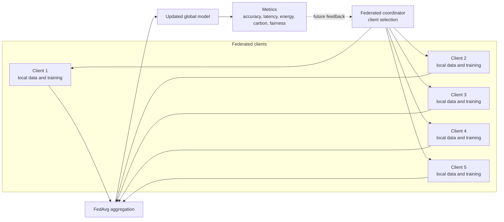
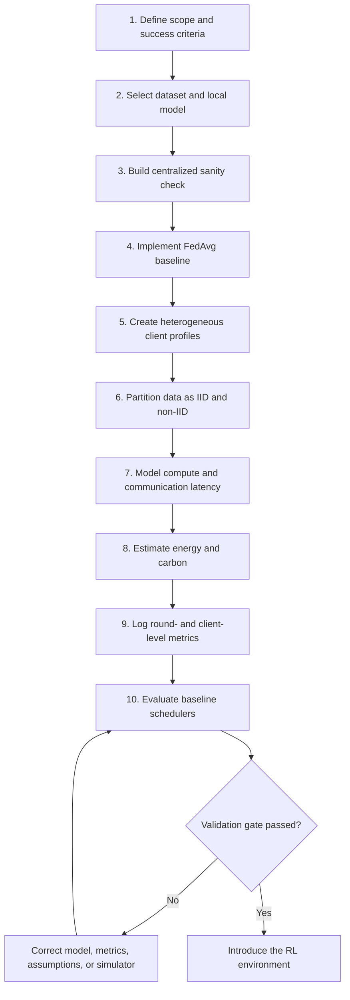
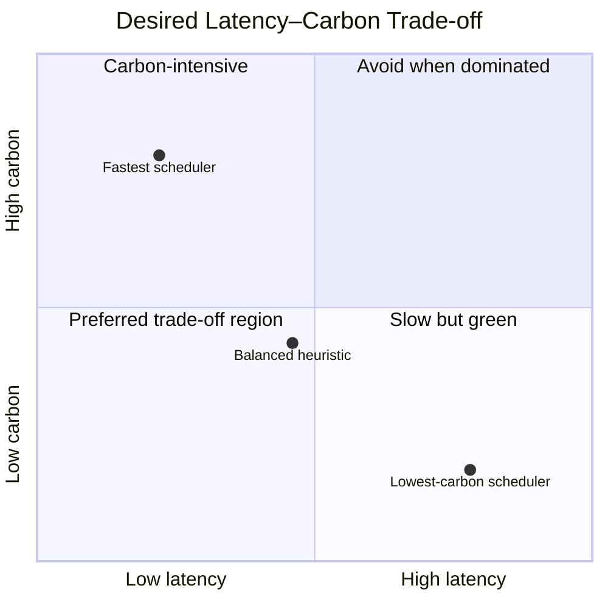
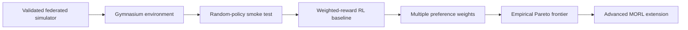

# First Steps for a Carbon-Aware Federated Learning Project

## Multi-Objective Reinforcement Learning for Latency–Carbon Optimization

**Document type:** Project initiation and first-week implementation guide  
**Audience:** Student project team, mentors, and academic reviewers  
**Recommended initial scope:** Simulation-first proof of concept with five heterogeneous federated clients

---

## 1. Executive Summary

This project aims to develop a **multi-objective reinforcement learning (MORL) scheduler** for federated learning. The scheduler will decide which clients should participate in each training round so that the global model reaches an acceptable accuracy with low training latency and low operational carbon emissions.

The project must not begin with reinforcement learning. An RL agent requires a reliable environment, meaningful actions, measurable outcomes, and credible comparison methods. The first phase should therefore build and validate a small federated-learning baseline that can answer four questions:

1. Does the global model learn successfully from distributed client data?
2. Can latency, energy, and carbon be calculated consistently for every client and round?
3. Do simple client-selection strategies reveal a genuine latency–carbon trade-off?
4. Are the results logged well enough to evaluate a future RL policy fairly?

The recommended first prototype uses **MNIST or Fashion-MNIST**, a small neural network, five simulated clients, Federated Averaging (FedAvg), and several rule-based schedulers. Reinforcement learning should be introduced only after this baseline passes the validation gate defined in this document.

> **Initial project objective:** Build a measurable and reproducible federated-learning simulator that demonstrates a latency–carbon trade-off while maintaining an explicit model-quality target.

---

## 2. System Boundary and Optimization Target

The optimization target is the **complete federated training process**, not the inference speed or carbon footprint of one standalone local AI model.

Each selected federated client trains a model locally. Local computation is one part of the total system; communication, synchronization, and server aggregation must also be represented.



For a synchronous federated round, the principal measurements are:

$$
T_{\mathrm{round}} =
\max_{i\in S_t}
\left(
T^{\mathrm{download}}_i+
T^{\mathrm{train}}_i+
T^{\mathrm{upload}}_i
\right)
+T^{\mathrm{aggregation}}
$$

$$
C_{\mathrm{round}} =
\sum_{i\in S_t}
\left(C^{\mathrm{compute}}_i+C^{\mathrm{communication}}_i\right)
+C^{\mathrm{aggregation}}
$$

where $S_t$ is the set of clients selected in round $t$.

The strongest final measures are **time-to-accuracy** and **carbon-to-accuracy**:

$$
T_{A^{\ast}}=\text{total time required to reach target accuracy }A^{\ast}
$$

$$
C_{A^{\ast}}=\text{total carbon emitted before reaching target accuracy }A^{\ast}
$$

These prevent the project from rewarding a scheduler merely for running fast or consuming little energy while failing to train a useful model.

---

## 3. Recommended Minimum Viable Scope

| Element | Initial decision | Reason |
|---|---|---|
| Learning task | Image classification | Simple, measurable, and easy to reproduce |
| Dataset | MNIST or Fashion-MNIST | Lightweight and suitable for federated partitioning |
| Clients | Five simulated clients | Enough heterogeneity to show trade-offs without a large action space |
| Global algorithm | FedAvg | Standard and easy to explain |
| Local model | Small multilayer perceptron or CNN | Fast enough for repeated experiments |
| Clients per round | Two or three | Produces meaningful selection decisions |
| Training mode | Synchronous rounds | Makes straggler latency explicit |
| Carbon data | Fixed documented values first | Avoids premature dependence on a live API |
| Schedulers | Random, round-robin, fastest, lowest-carbon, balanced heuristic | Creates interpretable baselines |
| RL | Excluded from the first baseline | Introduced only after environment validation |

### Out of scope for the first milestone

- Large language models
- Paid carbon-intensity APIs
- Many physical client devices
- Secure aggregation or differential privacy
- Multi-agent reinforcement learning
- Continuous bandwidth and CPU-frequency control
- Cloud-region migration
- Production deployment

These can become extensions after the core latency–carbon experiment is credible.

---

## 4. End-to-End First-Phase Workflow



---

## 5. Step-by-Step Implementation Guide

## Step 1 — Define the Scope, Research Question, and Success Criteria

### Purpose

Convert the broad project idea into a small question that can be implemented and tested:

> Can a client-selection policy reduce federated-learning latency and estimated operational carbon without preventing the global model from reaching a required accuracy?

### Why this step is necessary

Without a fixed boundary, the project can expand into hardware measurement, live electricity-grid integration, privacy, networking, cloud scheduling, and large-model training simultaneously. A precise scope determines what the simulator must represent and what claims the results can support.

### Inputs and tools required

- Mentor expectations and project duration
- Available computer specifications
- Expected team size and responsibilities
- A Markdown decision log or project charter
- Git for version control

### Actions

1. Fix the initial number of clients at five.
2. Select two or three clients per training round.
3. Use synchronous FedAvg and one local epoch initially.
4. Define a target test accuracy, such as a value established by a centralized sanity run rather than an arbitrary promise.
5. Define the initial objectives as latency and carbon, with accuracy as a constraint.
6. State that carbon values are **operational estimates**, not complete life-cycle emissions.
7. Record exclusions and possible extensions.

### Required output

A one-page project charter containing:

- Research question
- System boundary
- Assumptions
- Variables under the scheduler's control
- Metrics
- Minimum success criteria
- Explicit exclusions

### Contribution to the overall project

This becomes the reference against which design choices and mentor feedback are evaluated. It also prevents the RL agent from being given an unclear or unnecessarily large problem.

### Completion checklist

- [ ] The optimization target is the complete federated training process.
- [ ] Accuracy is defined as a constraint or objective.
- [ ] The first version changes client selection only.
- [ ] Operational-carbon assumptions are documented.
- [ ] Advanced features are listed as future work.

---

## Step 2 — Select the Dataset and Local Learning Task

### Purpose

Provide a controlled machine-learning workload for every federated client. The dataset creates the local training time, model updates, convergence behavior, and global accuracy that make the scheduling problem meaningful.

### Why MNIST or Fashion-MNIST is useful

MNIST contains grayscale handwritten digits. Fashion-MNIST uses the same image dimensions and class structure but contains clothing categories and is generally a more demanding classification task.

Their purpose in this project is **not to measure carbon directly**. They serve as:

- The workload executed by every client
- The source of private local client data
- A measurable global-accuracy benchmark
- A way to create IID and non-IID client populations
- A repeatable basis for comparing scheduling policies
- A lightweight task that permits many experiments on ordinary hardware

MNIST is recommended for the first debugging run. Fashion-MNIST is recommended after the pipeline works because it can expose larger differences between client-selection policies without creating the cost of a large dataset or model.

### Why this step is necessary

A scheduler that minimizes time and carbon could select no useful clients unless model progress is measured. A dataset and test set establish whether a low-cost schedule still produces a useful global model.

### Inputs and tools required

- MNIST or Fashion-MNIST
- PyTorch or TensorFlow
- A small multilayer perceptron or CNN
- A held-out global test set
- Fixed random seeds

### Actions

1. Download and preprocess the dataset.
2. Keep the official test set centralized for evaluation only.
3. Train the proposed small model centrally as a sanity check.
4. Record achievable accuracy, loss, runtime, and model-update size.
5. Freeze the initial architecture and preprocessing configuration.

### Required output

- Reproducible dataset loader
- Small model definition
- Centralized sanity-check metrics
- Recorded model size in bytes
- Selected target-accuracy rule for the federated experiments

### Contribution to the overall project

This step supplies the learning signal that prevents latency and carbon optimization from degrading model utility. Model size also becomes an input to communication-latency estimation.

### Completion checklist

- [ ] Dataset loads without manual intervention.
- [ ] Training and test transformations are documented.
- [ ] The centralized model learns above a naive baseline.
- [ ] Model/update size is measured.
- [ ] The same test set is used for all schedulers.

---

## Step 3 — Build the Baseline Federated-Learning Setup

### Purpose

Implement the minimum valid federated-learning cycle: distribute the global model, train selected clients locally, collect their model updates, aggregate them, and evaluate the new global model.

### Why this step is necessary

The future RL agent controls the federated environment. If the underlying training or aggregation logic is incorrect, the policy will optimize simulator errors rather than the intended problem.

### Inputs and tools required

- Dataset loader and local model from Step 2
- Python and PyTorch or TensorFlow
- A custom simulator or Flower
- FedAvg aggregation
- Configuration file for rounds, local epochs, learning rate, and selection count

### Actions

For each round $t$:

1. Start from global weights $w_t$.
2. Select clients using a simple scheduler.
3. Copy $w_t$ to each selected client.
4. Train locally to produce client weights $w^{(i)}_{t+1}$.
5. Aggregate client weights in proportion to their local sample counts:

$$
w_{t+1} =
\sum_{i\in S_t}
\frac{n_i}{\sum_{j\in S_t}n_j}
w^{(i)}_{t+1}
$$

6. Evaluate $w_{t+1}$ on the common test set.

### Required output

- A complete multi-round FedAvg run
- Global loss and accuracy per round
- Selected-client list per round
- Saved configuration and random seed
- A basic convergence plot

### Contribution to the overall project

This is the environment's learning engine. Every future scheduler—including MORL—must use exactly the same training and evaluation path for a fair comparison.

### Completion checklist

- [ ] The global model improves over multiple rounds.
- [ ] Aggregation is weighted by client data size.
- [ ] Unselected clients do not train in that round.
- [ ] Runs are reproducible under a fixed seed.
- [ ] Model evaluation is independent of the scheduler.

---

## Step 4 — Create Heterogeneous Simulated Client Profiles

### Purpose

Represent the differences in hardware, networks, data, and electricity that create the latency–carbon trade-off.

### Why this step is necessary

If all clients are identical, client selection has little effect. Heterogeneity is what gives the scheduler a real decision: a fast client may consume more power or use carbon-intensive electricity, while a greener client may train or communicate more slowly.

### Inputs and tools required

- One optional real-computer measurement for calibration
- Manufacturer power ranges or explicitly simulated values
- JSON or YAML client-profile configuration
- Seeded random-number generator for controlled variation

### Suggested initial profile fields

```yaml
client_id: client_01
compute_speed_factor: 1.20
compute_power_w: 65
idle_power_w: 12
bandwidth_down_mbps: 40
bandwidth_up_mbps: 15
network_latency_ms: 30
network_power_w: 4
carbon_intensity_g_per_kwh: 650
data_samples: 12000
availability_probability: 0.95
```

### Example population

| Client | Speed factor | Compute power | Upload bandwidth | Carbon intensity | Role in trade-off |
|---|---:|---:|---:|---:|---|
| C1 | 1.40 | 85 W | 35 Mbps | 700 gCO₂e/kWh | Fast, carbon-intensive |
| C2 | 1.00 | 55 W | 20 Mbps | 400 gCO₂e/kWh | Balanced |
| C3 | 0.70 | 32 W | 10 Mbps | 150 gCO₂e/kWh | Slow, low-carbon |
| C4 | 1.30 | 90 W | 45 Mbps | 620 gCO₂e/kWh | Fast, high-power |
| C5 | 0.80 | 40 W | 12 Mbps | 220 gCO₂e/kWh | Moderately green |

### Actions

1. Define at least fast, medium, and slow device types.
2. Avoid making power, speed, and carbon perfectly correlated.
3. Store profiles in configuration rather than source code.
4. Add small seeded variation to runtime and bandwidth.
5. Record which values are measured, referenced, or purely simulated.

### Required output

- Five documented and machine-readable client profiles
- A profile summary table
- Provenance labels for every parameter
- Optional calibration note based on the team's computer

### Contribution to the overall project

The profiles create the decision landscape from which Pareto trade-offs can emerge and later define part of the RL state.

### Completion checklist

- [ ] At least three device categories exist.
- [ ] Profiles contain compute, network, carbon, and data fields.
- [ ] Assumptions and units are explicit.
- [ ] Random variation is reproducible.
- [ ] No scheduler is trivially best on every metric.

---

## Step 5 — Partition the Dataset into IID and Non-IID Clients

### Purpose

Model how data is distributed across clients and test whether a scheduler preserves learning quality while optimizing infrastructure costs.

### Why this step is necessary

Real federated data is commonly non-identically distributed. A client may contain classes or patterns that other clients do not have. If a scheduler repeatedly selects only fast or low-carbon clients, it may exclude important data and harm global accuracy or fairness.

### IID partition

An IID partition gives every client a roughly similar class distribution. It is useful for debugging because infrastructure differences dominate the outcome.

$$
P_i(y=k)\approx P_j(y=k)
\quad \forall i,j,k
$$

### Non-IID partition

A non-IID partition intentionally gives clients different class distributions. A common method samples client class proportions from a Dirichlet distribution:

$$
\boldsymbol{p}_i\sim\mathrm{Dirichlet}(\alpha\mathbf{1})
$$

Smaller $\alpha$ generally produces stronger class imbalance; the selected value and seed must be reported.

For a simple demonstrator, a label-skew split may also be used—for example, each client receives mostly two classes—but a Dirichlet partition provides a more flexible experiment.

### Inputs and tools required

- Training portion of the selected dataset
- NumPy or the ML framework's sampling utilities
- Fixed seeds
- A plot or table of class counts by client

### Actions

1. Create one IID partition and verify class balance.
2. Create at least one non-IID partition with a documented method.
3. Keep the global test set unchanged.
4. Save indices rather than regenerating splits for every scheduler.
5. Plot a client-by-class distribution heatmap or stacked bar chart.

### Required output

- Saved IID client indices
- Saved non-IID client indices
- Per-client sample and class counts
- Distribution visualization
- Partition configuration and seed

### Contribution to the overall project

This step tests whether carbon and latency gains come at the cost of data diversity and model quality. It later helps define accuracy and participation constraints for MORL.

### Completion checklist

- [ ] All training samples are assigned according to a documented rule.
- [ ] No test data leaks into client training sets.
- [ ] Partitions are reused across scheduler comparisons.
- [ ] IID and non-IID distributions are visibly different.
- [ ] Per-client sample counts are logged.

---

## Step 6 — Model Training and Communication Latency

### Purpose

Estimate the elapsed time caused by local computation, model transfer, synchronization, and server aggregation.

### Why this step is necessary

Federated latency is not only local training time. Communication and the slowest selected client can dominate a synchronous round. Ignoring these terms would turn the project into a local-compute benchmark rather than a federated-computing study.

### Inputs and tools required

- Measured reference training time or simulated base time
- Client speed factors
- Serialized global-model and update sizes
- Upload/download bandwidth and base network delay
- Aggregation-time estimate
- A monotonic timer for real measurements

### Core formulas

For model size $M$ in bytes and bandwidth $B_i$ in megabits per second:

$$
T^{\mathrm{transfer}}_i =
\frac{8M}{10^6B_i}
+T^{\mathrm{network\ delay}}_i
$$

An initial compute model can be calibrated from reference time $T_{\mathrm{ref}}$:

$$
T^{\mathrm{train}}_i =
\frac{T_{\mathrm{ref}}}{s_i}
\times e_i
+\epsilon_i
$$

where $s_i$ is the client's speed factor, $e_i$ is its local-epoch count, and $\epsilon_i$ is small seeded noise.

Total client latency is:

$$
T_i
=T^{\mathrm{download}}_i
+T^{\mathrm{train}}_i
+T^{\mathrm{upload}}_i
$$

For synchronous execution:

$$
T_{\mathrm{round}}=\max_{i\in S_t}T_i+T^{\mathrm{aggregation}}
$$

### Actions

1. Measure or estimate serialized model and update sizes.
2. Separate download and upload bandwidth.
3. Compute each latency component independently.
4. Model synchronous round time using the slowest selected client.
5. Log both predicted and measured values whenever a real run is performed.
6. Add dropout and deadline behavior only after the deterministic version works.

### Required output

- Client-level compute, download, and upload times
- Round latency and identified straggler
- Cumulative time-to-accuracy
- Unit tests for conversion formulas

### Contribution to the overall project

Latency becomes one objective supplied to baseline schedulers and the future MORL reward vector.

### Completion checklist

- [ ] Bytes, bits, seconds, and Mbps conversions are tested.
- [ ] Compute and communication times are logged separately.
- [ ] Round latency reflects the slowest selected client.
- [ ] Total time accumulates across rounds.
- [ ] Model size is derived from the actual model artifact.

---

## Step 7 — Estimate Energy Consumption and Carbon Emissions

### Purpose

Translate client computation and communication activity into estimated operational energy and carbon emissions.

### Why this step is necessary

Carbon is the second optimization objective, but a computer does not directly report carbon emissions. Energy must first be estimated or measured, then multiplied by the electricity carbon intensity associated with the device's location and time.

### Inputs and tools required

- Client compute and network power values in watts
- Training and communication durations
- Carbon intensity in gCO₂e/kWh
- Optional watt meter, smart plug, OS power counters, or CodeCarbon for calibration
- Documented fallback estimates when counters are unavailable

### Core formulas

Compute energy:

$$
E^{\mathrm{compute}}_i(\mathrm{kWh}) =
\frac{P^{\mathrm{compute}}_i(\mathrm{W})
\times T^{\mathrm{train}}_i(\mathrm{s})}
{3{,}600{,}000}
$$

Communication energy:

$$
E^{\mathrm{comm}}_i(\mathrm{kWh}) =
\frac{P^{\mathrm{network}}_i
\times\left(T^{\mathrm{download}}_i+T^{\mathrm{upload}}_i\right)}
{3{,}600{,}000}
$$

Client carbon:

$$
C_i(\mathrm{gCO_2e}) =
\left(E^{\mathrm{compute}}_i+E^{\mathrm{comm}}_i\right)
\times CI_i
$$

Round carbon:

$$
C_{\mathrm{round}} =
\sum_{i\in S_t}C_i+C^{\mathrm{aggregation}}
$$

If wall power is measured, optional AI-attributable energy can subtract an idle baseline:

$$
E_{\mathrm{incremental}}
=E_{\mathrm{workload}}-P_{\mathrm{idle}}t
$$

### Actions

1. Start with fixed, documented carbon-intensity values per client.
2. Use consistent operational boundaries across all strategies.
3. Include compute energy first; add communication and aggregation using clearly stated estimates.
4. Validate formula outputs using hand-calculated examples.
5. Run sensitivity analysis with low, medium, and high power/carbon assumptions.
6. Label every result as measured, calibrated estimate, or simulated estimate.

### Required output

- Energy in kWh per client and round
- Carbon in gCO₂e per client and round
- Total carbon-to-accuracy
- Assumption and parameter table
- Sensitivity-analysis results

### Contribution to the overall project

This provides the carbon objective while maintaining scientific honesty about measurement uncertainty. It also lets the team evaluate whether a policy's reported improvement is robust to reasonable parameter changes.

### Completion checklist

- [ ] Watt-seconds are correctly converted to kWh.
- [ ] Carbon units are gCO₂e rather than confused with energy units.
- [ ] Compute, communication, and aggregation boundaries are stated.
- [ ] Parameter provenance is recorded.
- [ ] At least one manual calculation matches the implementation.

---

## Step 8 — Implement Reproducible Experiment Logging

### Purpose

Capture enough information to reproduce, debug, compare, and defend every experiment.

### Why this step is necessary

Federated and RL experiments contain randomness in model initialization, data partitioning, client selection, and simulated conditions. Final averages without round-level evidence cannot reveal whether a scheduler learned well, exploited a modeling error, or benefited from a favorable seed.

### Inputs and tools required

- CSV or Parquet for tabular metrics
- JSON or YAML for configuration
- Pandas and Matplotlib or Seaborn
- Git commit identifier where available
- Optional TensorBoard or MLflow

### Client-level log schema

| Field | Description |
|---|---|
| `run_id`, `seed`, `round` | Reproducibility identifiers |
| `scheduler`, `client_id`, `selected` | Decision information |
| `num_samples`, `local_epochs` | Local workload |
| `train_s`, `download_s`, `upload_s` | Latency components |
| `compute_kwh`, `comm_kwh` | Energy components |
| `carbon_gco2e` | Estimated client emissions |
| `local_loss` | Optional diagnostic learning metric |

### Round-level log schema

| Field | Description |
|---|---|
| `run_id`, `seed`, `round`, `scheduler` | Experiment identifiers |
| `selected_clients` | Scheduler action |
| `straggler_client` | Client determining synchronous latency |
| `round_latency_s`, `cumulative_latency_s` | Time metrics |
| `round_carbon_gco2e`, `cumulative_carbon_gco2e` | Carbon metrics |
| `global_loss`, `global_accuracy` | Model quality |
| `target_accuracy_reached` | Validation status |

### Actions

1. Generate a unique run identifier.
2. Save the complete resolved configuration before training.
3. Log every client, including unselected clients where useful.
4. Log after each round so partial runs remain diagnosable.
5. Save summary statistics separately from raw logs.
6. Make plotting scripts read logs rather than internal program state.

### Required output

- Per-client metrics file
- Per-round metrics file
- Resolved experiment configuration
- Summary table and plots
- Reproduction instructions

### Contribution to the overall project

These logs make baseline-to-RL comparisons fair and allow mentor-facing claims to be traced to exact runs and assumptions.

### Completion checklist

- [ ] Every result has a run ID, configuration, and seed.
- [ ] Raw and summarized data are stored separately.
- [ ] Units are present in column names or schema documentation.
- [ ] A plot can be regenerated from saved logs alone.
- [ ] Failed runs do not overwrite successful ones.

---

## Step 9 — Implement Baseline Client-Selection Schedulers

### Purpose

Create simple and interpretable reference strategies against which the future MORL agent must be compared.

### Why this step is necessary

An RL result is not meaningful merely because it obtains low latency or carbon. It must outperform or improve upon simpler approaches under the same dataset, client profiles, partitions, seeds, and training budget.

### Required schedulers

| Scheduler | Selection rule | Purpose |
|---|---|---|
| Random | Uniformly sample available clients | Neutral reference and variance estimate |
| Round-robin | Rotate participation deterministically | Participation-fair reference |
| Fastest | Select clients with lowest predicted total latency | Latency-optimized extreme |
| Lowest-carbon | Select clients with lowest predicted emissions | Carbon-optimized extreme |
| Balanced heuristic | Rank a normalized weighted score | Non-RL multi-objective reference |

For the balanced heuristic:

$$
\mathrm{score}_i
=w_T\widehat{T}_i+w_C\widehat{C}_i
$$

where $\widehat{T}_i$ and $\widehat{C}_i$ are normalized metrics. Lower scores are preferred.

Min–max normalization can initially be defined as:

$$
\widehat{x}_i
=\frac{x_i-x_{\min}}{x_{\max}-x_{\min}+\varepsilon}
$$

### Inputs and tools required

- Validated simulator
- Shared scheduler interface
- Fixed client count per round
- Identical experiment configurations and seeds
- Statistical and plotting utilities

### Actions

1. Implement every strategy behind the same interface.
2. Run each strategy for multiple seeds.
3. Repeat under IID and non-IID partitions.
4. Keep training budget and client count identical.
5. Compare accuracy, time-to-accuracy, carbon-to-accuracy, and participation.
6. Plot cumulative carbon versus cumulative latency and mark achieved accuracy.

### Required output

- Baseline result table with mean and variation
- Accuracy-versus-round curves
- Cumulative latency and carbon curves
- Client participation distribution
- A latency–carbon scatter plot or empirical Pareto plot

### Contribution to the overall project

These schedulers demonstrate whether a genuine conflict exists and set the minimum performance standard for MORL.



The plotted positions above are illustrative; the final document or presentation must use measured project results.

### Completion checklist

- [ ] All schedulers use the same interface and experiment budget.
- [ ] Random results include multiple seeds.
- [ ] Fastest and lowest-carbon strategies form interpretable extremes.
- [ ] The balanced heuristic uses normalized quantities.
- [ ] Accuracy and participation are reported alongside cost metrics.

---

## Step 10 — Validate the Baseline and Apply the RL Readiness Gate

### Purpose

Decide objectively whether the simulator is trustworthy enough to become an RL environment.

### Why this step is necessary

RL can exploit incorrect units, missing constraints, deterministic shortcuts, or unrealistic correlations. Introducing it before validating the baseline makes failures difficult to locate and improvements difficult to defend.

### Inputs and tools required

- Results from all baseline schedulers
- Unit and integration tests
- Centralized sanity-check results
- IID and non-IID experiments
- Sensitivity analysis
- Mentor review of system boundaries and assumptions

### Validation criteria

The project is ready for RL only if all essential criteria pass:

#### Functional validity

- [ ] FedAvg improves the global model across rounds.
- [ ] Dataset splits contain no train/test leakage.
- [ ] Every scheduler runs through the identical training pipeline.
- [ ] Fixed seeds reproduce selections and metrics within expected tolerance.

#### Measurement validity

- [ ] Latency units and transfer formulas pass hand calculations.
- [ ] Energy and carbon conversions pass hand calculations.
- [ ] Synchronous latency is controlled by the selected straggler.
- [ ] Measured, referenced, and simulated inputs are distinguishable.

#### Experimental validity

- [ ] At least one scheduler reaches the target accuracy.
- [ ] Latency-only and carbon-only strategies show a measurable trade-off.
- [ ] Non-IID selection can affect convergence or accuracy as expected.
- [ ] Results include multiple seeds or a documented reason for a temporary exception.
- [ ] Conclusions remain reasonable under sensitivity analysis.

#### RL environment readiness

- [ ] State variables are observable before the action is chosen.
- [ ] The action has an unambiguous effect on the selected clients.
- [ ] Reward components are available after each round.
- [ ] Empty or invalid selections are prevented or penalized.
- [ ] Episode termination and target-accuracy conditions are defined.

### Required output

- Validation report with pass/fail evidence
- Known limitations and unresolved risks
- Frozen baseline configuration
- RL environment specification draft
- Mentor approval to proceed to the RL phase

### Contribution to the overall project

This gate protects the credibility of the eventual MORL results and establishes a stable benchmark that should not be changed casually after RL experiments begin.

---

## 6. When Reinforcement Learning Should Be Introduced

Reinforcement learning should be introduced **after Step 10 passes**, not merely after the FedAvg code runs once.

The initial RL environment should remain deliberately small:

### State

For every available client, begin with:

$$
s_t=
\left[
\widehat{T}^{\mathrm{train}}_i,
\widehat{B}^{\mathrm{up}}_i,
\widehat{P}_i,
\widehat{CI}_i,
\widehat{n}_i,
\widehat{p}^{\mathrm{participation}}_i,
A_t
\right]_{i=1}^{N}
$$

where $A_t$ is current global accuracy. State values must be known before selection.

### Action

Select a fixed number $K$ of clients from $N$. In the first RL version, do not also optimize bandwidth, CPU frequency, compression, and local epochs.

### Reward vector

Prefer preserving the multi-objective structure:

$$
\mathbf{r}_t=
\begin{bmatrix}
-\widehat{T}_{\mathrm{round}}\\
-\widehat{C}_{\mathrm{round}}\\
+\Delta A_t\\
+F_t
\end{bmatrix}
$$

If a scalarized baseline is needed:

$$
R_t
=-w_T\widehat{T}_{\mathrm{round}}
-w_C\widehat{C}_{\mathrm{round}}
+w_A\widehat{\Delta A_t}
-\lambda V_t
$$

where $V_t$ represents accuracy, participation, deadline, or invalid-action violations.

### Episode termination

Terminate when either:

- Target accuracy $A^{\ast}$ is reached; or
- A maximum number of rounds or resource budget is exhausted.

### Recommended progression

1. Validate a random policy through a Gymnasium-compatible interface.
2. Train a simple weighted-reward DQN or PPO baseline.
3. Compare it against all heuristic schedulers using unseen seeds.
4. Train policies for several latency–carbon preference weights.
5. Construct an empirical Pareto frontier.
6. Only then consider preference-conditioned or Pareto-specific MORL methods.



---

## 7. Suggested Project Folder Structure

```text
carbon-aware-fl/
├── README.md
├── requirements.txt
├── pyproject.toml
├── configs/
│   ├── base.yaml
│   ├── clients.yaml
│   ├── iid.yaml
│   └── non_iid.yaml
├── data/
│   ├── raw/                  # downloaded datasets; usually Git-ignored
│   └── partitions/           # saved client index files
├── src/
│   ├── data/
│   │   ├── datasets.py
│   │   └── partition.py
│   ├── models/
│   │   └── classifier.py
│   ├── federated/
│   │   ├── client.py
│   │   ├── server.py
│   │   └── fedavg.py
│   ├── simulation/
│   │   ├── profiles.py
│   │   ├── latency.py
│   │   ├── energy.py
│   │   └── carbon.py
│   ├── schedulers/
│   │   ├── base.py
│   │   ├── random.py
│   │   ├── round_robin.py
│   │   ├── fastest.py
│   │   ├── lowest_carbon.py
│   │   └── balanced.py
│   ├── rl/                   # add only after the validation gate
│   │   ├── environment.py
│   │   └── rewards.py
│   ├── logging/
│   │   └── experiment.py
│   └── evaluation/
│       ├── metrics.py
│       └── plots.py
├── tests/
│   ├── test_fedavg.py
│   ├── test_partition.py
│   ├── test_latency.py
│   └── test_carbon.py
├── experiments/
│   ├── run_baselines.py
│   └── run_rl.py
├── results/                  # generated run folders; usually Git-ignored
└── docs/
    ├── project_charter.md
    ├── assumptions.md
    └── validation_report.md
```

### Purpose of this structure

- `configs/` keeps experimental choices out of source code.
- `data/partitions/` ensures every scheduler uses identical client data.
- `simulation/` separates estimation assumptions from learning logic.
- `schedulers/` enforces a common comparison interface.
- `rl/` remains isolated until the baseline passes validation.
- `tests/` protects mathematical conversions and aggregation logic.
- `results/` stores complete, independently reproducible experiment runs.

---

## 8. First-Week Implementation Plan

The schedule assumes a small student team. If one person is implementing it, preserve the order and extend the timeline rather than skipping validation.

| Day | Primary work | Purpose | End-of-day deliverable |
|---|---|---|---|
| Day 1 | Freeze scope, assumptions, metrics, and repository structure | Prevent scope drift and define success | Project charter, Git repository, base configuration |
| Day 2 | Load MNIST; build and centrally train a small model | Verify the dataset/model pipeline before federation | Reproducible sanity run, accuracy curve, model size |
| Day 3 | Implement five-client FedAvg with random or round-robin selection | Establish the working federated core | Multi-round global accuracy and loss logs |
| Day 4 | Save IID/non-IID partitions and create heterogeneous client profiles | Introduce realistic data and infrastructure variation | Partition plots and documented client table |
| Day 5 | Add latency, energy, and carbon models with tests | Make costs measurable and trustworthy | Per-client/round metrics and passing formula tests |
| Day 6 | Implement all baseline schedulers and experiment logging | Demonstrate selection trade-offs | Reproducible baseline runs for IID data |
| Day 7 | Run non-IID comparisons, sensitivity checks, plots, and readiness review | Test credibility and decide whether RL can begin | Baseline report and completed validation checklist |

### First-week milestone checklist

#### Project definition

- [ ] Research question and boundaries are frozen.
- [ ] Target-accuracy rule is documented.
- [ ] Claims are limited to estimated operational carbon.

#### Learning pipeline

- [ ] MNIST or Fashion-MNIST loads reproducibly.
- [ ] Centralized sanity check succeeds.
- [ ] Five-client FedAvg improves global accuracy.

#### Simulation

- [ ] Five heterogeneous profiles exist.
- [ ] IID and non-IID partitions are saved.
- [ ] Compute and communication latency are separated.
- [ ] Energy and carbon formulas pass unit checks.

#### Evaluation

- [ ] Raw metrics, configuration, and seeds are saved.
- [ ] Five baseline schedulers use the same interface.
- [ ] Results include accuracy, latency, carbon, and participation.
- [ ] At least one visible latency–carbon trade-off is demonstrated.

#### Decision

- [ ] Validation criteria have been reviewed.
- [ ] Known limitations are documented.
- [ ] RL is introduced only if the readiness gate passes.

---

## 9. Minimum Experiment Matrix

Run the following matrix before claiming that the baseline phase is complete:

| Dimension | Values |
|---|---|
| Dataset partition | IID, non-IID |
| Scheduler | Random, round-robin, fastest, lowest-carbon, balanced |
| Seeds | At least 3 initially; preferably 5 for final reporting |
| Clients | 5 total, fixed selection of 2 or 3 per round |
| Accuracy target | Same rule for every run |
| Maximum rounds | Same value for every scheduler |
| Client profiles | Frozen within each comparison |

For each configuration, report:

- Final global accuracy and loss
- Rounds to target accuracy
- Time-to-accuracy
- Carbon-to-accuracy
- Total energy
- Deadline or target failures
- Client participation counts
- Mean and variability across seeds

If a scheduler fails to reach the target, do not compare only its raw time or carbon with successful schedulers. Report the failure explicitly.

---

## 10. Expected First-Milestone Results

A successful baseline should make the central trade-off visible:

- **Fastest-client selection** should usually reduce round latency but may prefer power-hungry or carbon-intensive clients.
- **Lowest-carbon selection** should usually reduce emissions but may increase synchronization delay or exclude useful data.
- **Round-robin selection** should improve participation fairness but may select stragglers.
- **Random selection** should provide a neutral but variable reference.
- **Balanced selection** should produce an intermediate trade-off, establishing a meaningful non-RL benchmark.

The exact result must emerge from the experiment; the simulator should not be engineered to guarantee a preferred conclusion. If all schedulers perform almost identically, inspect client heterogeneity, data partitions, metric scaling, model size, and selected-client count before adding RL.

### Suggested summary table

| Scheduler | Target reached? | Accuracy | Time-to-accuracy | Carbon-to-accuracy | Participation fairness |
|---|---:|---:|---:|---:|---:|
| Random | — | — | — | — | — |
| Round-robin | — | — | — | — | — |
| Fastest | — | — | — | — | — |
| Lowest-carbon | — | — | — | — | — |
| Balanced | — | — | — | — | — |

---

## 11. Key Risks and Early Controls

| Risk | Consequence | Early control |
|---|---|---|
| Carbon objective dominates | Agent selects too little useful training | Treat accuracy as a constraint and fix clients per round |
| Incorrect unit conversion | Misleading emissions claims | Unit tests and manual examples |
| Identical client profiles | No meaningful scheduling trade-off | Use documented heterogeneous profiles |
| Non-IID clients ignored | High infrastructure efficiency but poor accuracy | Report data distributions, accuracy, and participation |
| Model too large | Slow debugging and few repeat runs | Begin with MNIST/Fashion-MNIST and a small network |
| Simulator overfitting | RL exploits artificial patterns | Use stochastic validation seeds and sensitivity analysis |
| Unfair baseline comparison | Invalid RL claims | Freeze the environment, budget, partitions, and seeds |
| Measurement uncertainty | Carbon values appear more precise than evidence allows | Label estimates and report sensitivity ranges |
| Scope expansion | Project does not reach a demonstrable result | Enforce the minimum viable scope and RL gate |

---

## 12. Mentor Review Questions

At the end of the first week, the team should be able to answer:

1. What exactly is included in the system's carbon boundary?
2. Which inputs are measured, referenced, calibrated, or simulated?
3. Why is the dataset necessary, and how does non-IID data affect scheduling?
4. How are local training, communication, synchronization, and aggregation represented?
5. Can another person reproduce a run from its configuration and seed?
6. Do simple schedulers exhibit a measurable latency–carbon conflict?
7. Does every reported improvement preserve the target accuracy?
8. What is the strongest baseline that the RL agent must beat?
9. Which simulator behaviors have been validated by tests or real measurements?
10. Has the environment passed the readiness gate for reinforcement learning?

---

## 13. Definition of Done for the First Phase

The first phase is complete when the team has:

- A reproducible five-client federated-learning simulator
- A working FedAvg global training loop
- Saved IID and non-IID dataset partitions
- Documented heterogeneous client profiles
- Separated compute and communication latency models
- Documented energy and carbon estimates
- Complete client- and round-level logs
- Comparable results for all baseline schedulers
- Evidence of the latency–carbon–accuracy relationship
- A completed validation report
- A frozen environment specification ready for RL

The most important principle is:

> **Build, measure, and validate the federated environment first. Introduce reinforcement learning only after simple schedulers can be compared fairly and the latency, carbon, and accuracy calculations are demonstrably correct.**

---

## 14. Immediate Next Action

Create the repository structure and `project_charter.md`, then implement a centralized MNIST sanity run. This is the smallest useful action because it validates the dataset, model, runtime, accuracy metric, and model size before federated complexity is introduced.

The first federated milestone should follow immediately: split the same training dataset among five clients, run FedAvg with round-robin selection, and record global accuracy after every round.
